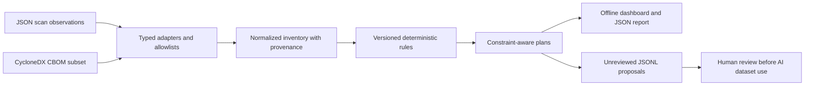

# Crypto Remediation Workbench

**Turn cryptographic inventory and scan observations into evidence-backed remediation decisions.**

A local-first cybersecurity portfolio project for CBOM analysis, enterprise cryptographic migration, and structured handoff to AI engineers. It includes an offline dashboard, eight explainable rules, infrastructure-aware plans, and a reproducible synthetic evaluation dataset.

> Demonstration software using fictional applications. It does not scan networks, execute remediations, implement cryptographic primitives, certify compliance, or claim independent expert validation.

## Review it in five minutes

1. Read [the case study](docs/CASE_STUDY.md) for the problem and three decision scenarios.
2. Open [the self-contained dashboard](demo/index.html) after downloading the repository; no server or dependencies are required. GitHub displays HTML source, so use **Download ZIP**, unzip, then open `demo/index.html` locally.
3. Inspect [the example report](demo/report.json) and [AI engineering handoff](demo/handoff.jsonl).
4. Review [the benchmark results](demo/evaluation.json), [tests](tests/test_engine.py), and [design](docs/ARCHITECTURE.md).

## Run the project

Requires Python 3.11 or newer. The application and tests use only the Python standard library.

```bash
python scripts/generate_demo.py
python -m cryptoworkbench.cli analyze examples/enterprise.scan.json examples/partner.cdx.json --out build
python -m cryptoworkbench.cli serve --directory build
```

Open **http://127.0.0.1:8765**. Search by application, owner, or rule; filter severity and classification; open a finding to review constraints, plan and provenance; export the filtered queue. Alternatively, open `build/index.html` directly.

```bash
python -m unittest discover -s tests -v
python scripts/evaluate.py
```

The generated portfolio contains **25 fictional applications and 105 observations**. The generator is deterministic. The checked-in demo can be rebuilt with `--out demo` followed by copying `build/evaluation.json` to `demo/evaluation.json`.

## What it analyzes

| Rule | Decision | Classification |
|---|---|---|
| TLS-001 | SSL or TLS 1.0/1.1 enabled | Weakness |
| TLS-002 | TLS 1.2 observed without TLS 1.3 | Migration candidate |
| ENC-001 | DES/3DES/RC4 or ECB mode | Weakness |
| ENC-002 | Explicit organizational AES-256-GCM requirement unmet | Policy deviation |
| SSH-001 | DSA host keys or RSA/SHA-1 signatures | Weakness |
| KEY-001 | Scanner-reported plaintext credential or key | Potential weakness; private validation required |
| VPN-001 | Legacy IKE, encryption or DH group | Demonstration baseline deviation |
| PQC-001 | RSA/ECC dependency requiring quantum migration planning | Migration candidate |

AES-128-GCM is not automatically treated as weak. An RSA SSH key using RSA/SHA-2 signatures is not treated as RSA/SHA-1. PQC planning distinguishes key establishment from signatures. An observation of TLS 1.2 is not proof that all other versions are unsupported: confirm scan coverage before action.

## Inputs and outputs

- `workbench.scan.v1`: documented normalized JSON contract for TLS, cipher, SSH, secret, IPsec and public-key observations. Upstream scanner conversion is explicit; this is not a universal scanner parser.
- CycloneDX 1.6/1.7: a deliberately narrow adapter supporting native TLS protocol properties, optional namespaced observation/context properties, and nested components. It does not fully validate the CycloneDX schema or implement all crypto asset types. Plain SBOM components do not establish runtime crypto posture.
- Outputs: a sanitized inventory, ranked finding report, self-contained HTML dashboard, and review-gated JSONL proposals.

See [the input contract](docs/INPUTS.md) and [security handling](SECURITY.md) before using non-demo inputs.

## Technical design



No model or external service is required. The AI contribution is a structured handoff contract, not a trained model or autonomous agent. The priority score is a transparent portfolio heuristic, not CVSS.

## Evaluation and limitations

The 21 checked-in scenarios include positive cases and negative controls. Precision and recall evaluate rule-label agreement against authored expectations. They are regression metrics on a small synthetic dataset, not measurements of real-world detection performance. See [evaluation methodology](docs/EVALUATION.md).

The workbench cannot infer undocumented hardware capability, validate secret authenticity, discover all cryptography, or prove a remediation is safe. Unknown protocols/algorithms can remain outside rule coverage; no finding does not imply security. Recommendations require expert review, runtime confirmation, compatibility tests and change approval.

## Standards references

- [CycloneDX 1.6 JSON reference](https://cyclonedx.org/docs/1.6/json/)
- [NIST SP 800-52 Rev. 2 TLS guidance](https://csrc.nist.gov/pubs/sp/800/52/r2/final)
- [OpenSSH 8.8 RSA/SHA-1 clarification](https://www.openssh.com/txt/release-8.8)
- [NIST SP 800-57 Part 1 key management](https://csrc.nist.gov/pubs/sp/800/57/pt1/r5/final)
- [RFC 8247 IKEv2 algorithm guidance](https://www.rfc-editor.org/rfc/rfc8247)
- [FIPS 203 ML-KEM](https://csrc.nist.gov/pubs/fips/203/final), [FIPS 204 ML-DSA](https://csrc.nist.gov/pubs/fips/204/final), [FIPS 205 SLH-DSA](https://csrc.nist.gov/pubs/fips/205/final)

Rules reflect an explicitly limited demonstration policy. References supply technical context, not a claim that every rule or organizational requirement is mandated by those publications. Reassess policy as standards evolve.

## License

MIT. See [LICENSE](LICENSE).
